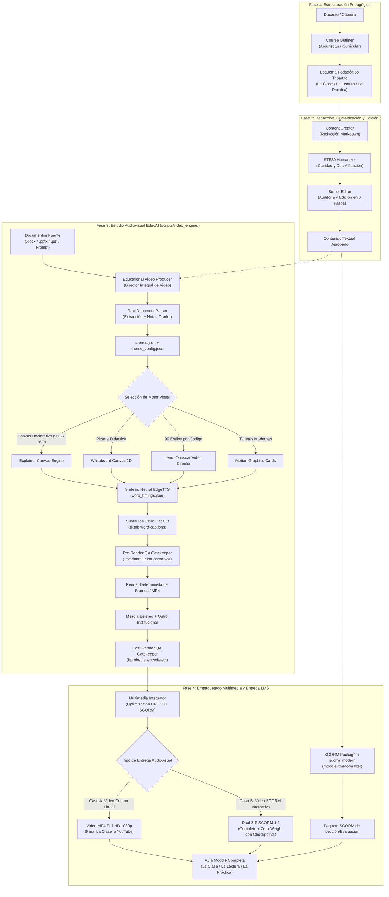

# SCORM Course Generator

Sistema profesional para la generación de contenidos didácticos en formato SCORM 1.2, compatible con cualquier LMS (Learning Management System).

[](https://www.python.org/)
[](https://scorm.com/)
[](LICENSE)

---

## Índice

- [Descripción General](#descripción-general)
- [Características Principales](#características-principales)
- [Requisitos del Sistema](#requisitos-del-sistema)
- [Instalación](#instalación)
- [Inicio Rápido](#inicio-rápido)
- [Arquitectura Multi-Agente](#arquitectura-multi-agente)
- [Estructura del Proyecto](#estructura-del-proyecto)
- [Guía Completa de Scripts](#guía-completa-de-scripts)
- [Integración Multimedia](#integración-multimedia)
- [Centro de Ayuda y Guías Ilustradas](#centro-de-ayuda-y-guías-ilustradas)
- [Importación en LMS](#importación-en-lms)
- [Estándares de Calidad](#estándares-de-calidad)
- [Resolución de Problemas](#resolución-de-problemas)
- [Ejemplos de Cursos](#ejemplos-de-cursos)
- [Contribuciones](#contribuciones)
- [Licencia](#licencia)

---

## Descripción General

Este proyecto utiliza una **arquitectura multi-agente basada en IA** para crear contenidos didácticos de alta calidad en formato SCORM 1.2. El sistema divide el proceso de creación en fases especializadas, cada una gestionada por un agente dedicado con competencias específicas.

### ¿Por qué SCORM 1.2?

SCORM 1.2 es el estándar de e-learning más confiable y universalmente compatible:

| Ventaja | Descripción |
|-----------|-------------|
| **Compatibilidad Universal** | Funciona en cualquier LMS moderno |
| **Fiabilidad** | Estándar maduro y estable desde 2001 |
| **Seguimiento** | Soporta el estado de finalización y el progreso del usuario |
| **Portabilidad** | Un único paquete funciona en cualquier parte |
| **Listo para modo local** | Se puede visualizar localmente sin necesidad de un LMS |

### LMS Soportados

- **Moodle** (todas las versiones)
- **Canvas** (Instructure)
- **Blackboard Learn**
- **Google Classroom**
- **TalentLMS**
- **Schoology**
- **D2L Brightspace**
- **SAP Litmos**
- **Docebo**
- **iSpring Learn**
- Y cualquier otro LMS compatible con SCORM 1.2

---

## Características Principales

### Generación de Contenidos
- **Creación Automática**: Desde un simple esquema hasta un curso completo
- **Calidad Profesional**: Contenidos pedagógicamente válidos y gramaticalmente correctos
- **Optimización en Español**: Soporte completo para acentos, caracteres especiales y tono formal/informal

### Formateo
- **Markdown → HTML**: Conversión automática con estilos profesionales
- **Tablas Responsivas**: Visualización perfecta tanto en escritorio como en dispositivos móviles
- **Navegación Integrada**: Botones de Anterior/Siguiente/Índice

### Multimedia & Estudio de Video EducAI
- **Estudio Unificado de Video (`scripts/video_engine/`)**: Generación de videos didácticos deterministas a partir de documentos (`.docx`, `.pptx`, `.pdf`) o prompts con síntesis neural EdgeTTS.
- **Subtítulos Dinámicos Estilo CapCut**: Resaltado activo palabra por palabra (`WordBoundary`) con tipografía de alto impacto y zona segura.
- **SCORM de Video Pasivo**: Reproductor HTML5 con seguimiento de finalización al 90% visto (`create_video_scorm.py`).
- **Video-Cuestionario SCORM 1.2 Interactivo**: Pausas evaluativas automáticas con preguntas formativas sincronizadas al fin de escena que reportan nota en el calificador de Moodle.
- **Empaquetado Dual ZIP**: Emisión de paquete completo autocontenido y paquete liviano Zero-Weight (< 400 KB) con enlace a CDN/streaming.
- **Motores Visuales Integrados**: Explainer Canvas declarativo (adaptable a 9:16 vertical y 16:9 horizontal), Pizarra Whiteboard, Motion Graphics y 99 estilos artísticos en código Lemo-Opuscar.
- **SCORM de Audio & Podcasts**: Reproductor de audio con seguimiento y generador de podcasts de cátedra con acento rioplatense (`podcast_engine.py`).
- **Compresión Inteligente**: Optimización automática con FFmpeg (CRF 23).

### Seguimiento
- **API SCORM**: Comunicación completa con el LMS
- **Estado de Finalización**: de `incomplete` a `completed`
- **Puntuaciones**: Soporte para el reporte de calificaciones (`score raw`)

---

## Requisitos del Sistema

### Obligatorios

| Requisito | Versión | Notas |
|-----------|----------|------|
| **Python** | 3.8+ | Probado en 3.9, 3.10, 3.11, 3.14 |
| **Claude Code / Antigravity** | Última | Para el uso de agentes de IA |

### Opcionales

| Requisito | Versión | Uso |
|-----------|----------|----------|
| **ffmpeg** | 4.0+ | Compresión de video/audio |
| **Git** | 2.0+ | Control de versiones |

### Instalación de ffmpeg

**Windows (con Chocolatey):**
```powershell
choco install ffmpeg
```

**Windows (manual):**
1. Descarga desde https://ffmpeg.org/download.html
2. Extrae los archivos en `C:\ffmpeg`
3. Añade `C:\ffmpeg\bin` al PATH del sistema

**macOS:**
```bash
brew install ffmpeg
```

**Linux (Ubuntu/Debian):**
```bash
sudo apt update && sudo apt install ffmpeg
```

---

## Instalación

### 1. Clona el Repositorio

```bash
git clone https://github.com/tuusername/scorm-course-generator.git
cd scorm-course-generator
```

### 2. Verifica Python

```bash
python --version  # Debe ser 3.8+
```

### 3. Crea el Entorno Virtual (Opcional)

```bash
python -m venv venv

# Windows
Set-ExecutionPolicy -ExecutionPolicy Bypass -Scope Process; .\venv\Scripts\Activate.ps1

# macOS/Linux
source venv/bin/activate
```

### 4. Verifica la Instalación

```bash
python scripts/scorm_generators/create_scorm_package.py --help
```

---

## Inicio Rápido

### Método 1: Usando los Agentes de IA (Recomendado)

La forma más sencilla de crear un curso completo es utilizar los agentes de IA integrados:

```
1. Abre tu terminal de IA en el directorio del proyecto.
2. Solicita: "Quiero crear un curso sobre [TEMA]"
3. El agente de estructura de cursos te entrevistará para definir los requisitos.
4. Los agentes de creación, edición y empaquetado generarán automáticamente el archivo SCORM final.
```

### Método 2: Usando los Scripts Directamente

#### Paso 1: Prepara el Contenido

Crea un archivo markdown con la siguiente estructura:

```markdown
# Módulo 1: Introducción

## Objetivos de Aprendizaje
- Comprender los conceptos básicos
- Aplicar las técnicas fundamentales

## Contenido
Texto del módulo...

# Módulo 2: Profundización

## Objetivos de Aprendizaje
...
```

#### Paso 2: Genera el Paquete SCORM

```bash
python scripts/scorm_generators/create_scorm_package.py
```

#### Paso 3: Importa en tu LMS

Sube el archivo `.zip` generado a tu LMS como "Paquete SCORM".

---

## Arquitectura Multi-Agente y Pipeline E2E

Este proyecto opera mediante un **pipeline integral de producción didáctica y audiovisual** orquestado por un ecosistema de **agentes inteligentes especializados** (`.claude/agents/`) y un catálogo de **habilidades operativas deterministas** (`.agents/skills/`). 

La arquitectura está diseñada para dar soporte a la metodología de **Aula Moodle** (Modelo Tripartito: *La Clase*, *La Lectura*, *La Práctica*), permitiendo transformar desde un simple esquema curricular o un documento en bruto (`.pptx`, `.docx`, `.pdf`) hasta un paquete educativo completo listo para desplegar en el campus virtual.



---

### El Elenco de Agentes Inteligentes (`.claude/agents/`)

Cada agente representa un rol profesional dentro del equipo docente y técnico, con responsabilidades, insumos y entregables estrictamente delimitados:

#### 1. Course Outliner (`course-outliner` · Naranja)
- **¿Qué hace?**: Actúa como el arquitecto pedagógico. Entrevista al docente o analiza el programa de la materia para formular un esquema estructurado basado en la Taxonomía de Bloom y la metodología tripartita (*La Clase*, *La Lectura*, *La Práctica*).
- **Entradas**: Directivas del docente, objetivos de aprendizaje, carga horaria y nivel formativo.
- **Salidas**: Esquema curricular detallado con desglose de unidades, temas y propuestas de actividades.
- **Funcionamiento Aislado**: Puede ejecutarse independientemente para estructurar nuevas carreras, diplomaturas o cursos antes de redactar una sola línea de contenido.
- **Integración**: Su salida alimenta directamente a `content-creator` y a `educational-video-producer` con los ejes temáticos a desarrollar.

#### 2. Content Creator (`content-creator` · Azul)
- **¿Qué hace?**: Redacta el contenido didáctico en profundidad. Transforma los títulos y temas del esquema en lecciones explicativas, lecturas guiadas, casos prácticos y actividades formativas en Markdown.
- **Entradas**: Esquema curricular producido por `course-outliner`.
- **Salidas**: Documentos Markdown estructurados con encabezados normativos, tablas responsivas y bloques de apoyo pedagógico (`:::apoyo:::`).
- **Funcionamiento Aislado**: Puede redactar módulos individuales o actualizar lecciones puntuales sin necesidad de reestructurar el curso.
- **Integración**: Entrega sus borradores a `ste80-humanizer` y `senior-editor` para la fase de curaduría.

#### 3. Senior Editor (`senior-editor` · Rojo)
- **¿Qué hace?**: Audita y refina los textos bajo un estricto **protocolo de 6 pasos**:
  1. *Mecánica*: Ortografía, acentuación perfecta en español y gramática.
  2. *Claridad*: Desarticulación de oraciones complejas.
  3. *Concisión*: Eliminación de redundancias y paja académica.
  4. *Consistencia*: Coherencia terminológica y tono formal/cercano.
  5. *Andragogía*: Adaptación al ritmo de lectura en pantallas.
  6. *Fluidez*: Transiciones pedagógicas naturales entre conceptos.
- **Entradas**: Borradores generados por `content-creator` o textos provistos por docentes.
- **Salidas**: Archivos `course-content-edited.md` listos para producción final.
- **Funcionamiento Aislado**: Puede ser llamado para auditar y corregir cualquier documento o artículo externo.
- **Integración**: Valida los textos antes de que pasen a empaquetado SCORM (`moodle-xml-formatter`) o a locución de video.

#### 4. Educational Video Producer (`educational-video-producer` · Azul Marino)
- **¿Qué hace?**: Director general del estudio audiovisual didáctico. Ingesta documentos de cátedra, conduce el briefing interactivo de estilos gráficos, coordina la síntesis de voz sincronizada, supervisa las compuertas de calidad pre y post-render, y gestiona la entrega dual (Video Común vs. Video-Cuestionario SCORM 1.2).
- **Entradas**: Presentaciones PowerPoint (`.pptx`), documentos Word (`.docx`), PDFs, imágenes de logotipos institucionales o prompts temáticos.
- **Salidas**: `scenes.json`, videos Full HD 1080p (`*_EducAI_Final.mp4`) y paquetes SCORM interactivos.
- **Funcionamiento Aislado**: Puede crear piezas de video completas a partir de cualquier archivo docente en un solo paso mediante `scripts/video_engine/orchestrator.py`.
- **Integración**: Se nutre de los contenidos aprobados por `senior-editor` o de archivos del docente, y deriva la animación especializada a `lemo-opuscar-video-director` y el empaquetado a `multimedia-integrator`.

#### 5. Lemo-Opuscar Video Director (`lemo-opuscar-video-director` · Cian)
- **¿Qué hace?**: Diseña y dirige animaciones y videos explicativos por código utilizando el catálogo de **99 estilos artísticos** de Lemo-Opuscar (Canvas, WebGL, Three.js, SVG Mocap, Ukiyo-e, Blueprint, Vintage Engraving, Ink Wash, etc.).
- **Entradas**: Ejes conceptuales, dinámicas de procesos o metáforas visuales de la unidad.
- **Salidas**: Código reproducible en HTML/JS y videos Full HD 1080p (.mp4) con subtítulos normativos (.srt).
- **Funcionamiento Aislado**: Puede producir clips artísticos autónomos, intros animadas o visualizaciones de datos independientes.
- **Integración**: Provee el formato de video animado complementario para el bloque **La Clase** en coordinación con `educational-video-producer` y `multimedia-integrator`.

#### 6. Multimedia Integrator (`multimedia-integrator` · Morado)
- **¿Qué hace?**: Especialista en optimización de medios y empaquetado interactivo. Analiza pesos, aplica compresión FFmpeg inteligente (CRF 23) y genera paquetes SCORM dedicados para audios/podcasts y videos (tanto en modo pasivo al 90% como en modo interactivo con checkpoints en formato Dual ZIP).
- **Entradas**: Archivos de audio (MP3, WAV), videos (MP4, WEBM) y listas de preguntas evaluativas (`checkpoints`).
- **Salidas**: Paquetes SCORM 1.2 listos para Moodle (`_SCORM_Completo.zip` y `_SCORM.zip` Zero-Weight < 400 KB) y archivos multimedia optimizados.
- **Funcionamiento Aislado**: Permite empaquetar o comprimir cualquier video o audio externo sin tocar el resto del curso.
- **Integración**: Recibe los videos renderizados por `educational-video-producer` o `lemo-opuscar-video-director` y los transforma en actividades calificables para el libro de calificaciones de Moodle.

#### 7. SCORM Packager (`moodle-xml-formatter` · Verde)
- **¿Qué hace?**: Compila lecciones y evaluaciones escritas en Markdown a paquetes estándar SCORM 1.2 (`imsmanifest.xml`), asegurando compatibilidad universal con Moodle, Canvas, Blackboard, etc.
- **Entradas**: Markdown estructurado o archivo `config.yaml` (`scorm_modern`).
- **Salidas**: Archivos `.zip` instalables con seguimiento de lección, estado `completed` y reporte de calificación (`cmi.core.score.raw`).
- **Funcionamiento Aislado**: Se invoca directamente vía CLI mediante `create_scorm_package.py` o `create_scorm_modern_package.py`.
- **Integración**: Cierra la Fase 2 y Fase 4 convirtiendo los textos de cátedra en actividades formales del aula virtual.

---

### Catálogo de Habilidades Operativas (`.agents/skills/`)

Las habilidades son herramientas programáticas especializadas que ejecutan tareas técnicas deterministas bajo estándares rigurosos:

| Habilidad (`Skill`) | Propósito Técnico | Herramientas / Librerías | Entregable Garantizado |
| :--- | :--- | :--- | :--- |
| **`educational-video-producer`** | Orquestación integral del flujo dual (Caso A lineal vs. Caso B SCORM) y aplicación de invariantes técnicas. | `scripts/video_engine/orchestrator.py` | Video final validado y empaquetado bajo los estándares de `AGENTS.md`. |
| **`raw-document-video-parser`** | Ingesta profunda de documentos docentes multiformato con extracción de diapositivas y notas del orador. | `python-pptx`, `python-docx`, `pypdf`, `pymupdf`, `pdfplumber` | Archivo `scenes.json` normalizado con jerarquías y texto de locución. |
| **`tiktok-word-captions`** | Generación de subtítulos dinámicos estilo CapCut con resaltado activo palabra por palabra (Invariante 5). | `edge-tts` (eventos `WordBoundary`), formato `.ass` karaoke (`libass`) | Archivos `word_timings.json` y `captions.ass` sincronizados al milisegundo. |
| **`pre-render-composition-validator`** | Compuerta de calidad previa al render para detectar inconsistencias, duraciones dispares y errores JS/CSS. | Headless Chromium, Playwright, analizador JSON de timelines | Aprobación formal (0 errores de consola, duraciones alineadas, checkpoints al fin de voz). |
| **`post-render-video-qa`** | Auditoría posterior al ensamble del video final MP4. | `ffprobe`, `ffmpeg` (`silencedetect`, descarte de fotogramas negros) | Confirmación de stream de video H.264 + audio AAC estéreo sin caídas abruptas. |
| **`interactive-scorm-video-packager`** | Generación de paquetes SCORM 1.2 interactivos con pausas evaluativas y arquitectura Dual ZIP. | SCORM 1.2 API Wrapper, HTML5 Player seguro sobre `#player-container` | Paquete autocontenido (`_SCORM_Completo.zip`) y paquete liviano (`_SCORM.zip` < 400 KB). |
| **`modular-video-orchestrator`** | Renderizado modular por lotes de escenas con caché en disco para evitar saturación de memoria en videos largos. | Node.js, Puppeteer/Playwright, FFmpeg | Fotogramas PNG a 24 fps cacheados en disco listos para multiplexado determinista. |
| **`explainer`** | Motor declarativo Canvas 2D adaptativo a 4 relaciones de aspecto (`9:16`, `16:9`, `1:1`, `4:5`). | `explainer.json`, Zod, `compilador.mjs`, `simular.cjs` (Node sin navegador) | Página HTML autónoma, simulación sin errores y exportación MP4 Full HD. |
| **`lemo-opuscar`** | Catálogo de 99 estilos artísticos por código (Blueprint, Vintage Engraving, Ink Wash, etc.). | Canvas 2D, SVG Mocap, Three.js, WebGL | Código reproducible y video animado con estética editorial de alta gama. |
| **`notebooklm`** | Síntesis explicativa narrada y estructurada a partir de fuentes documentales oficiales de cátedra. | NotebookLM CLI / Gemini API | Resumen conceptual y video narrado oficial para **La Clase**. |
| **`curriculum-knowledge-architecture-designer`** | Mapeo epistémico de asignaturas para secuenciación didáctica óptima. | Taxonomías curriculares y andragogía | Matriz de prerrequisitos conceptuales y progresión del aprendizaje. |
| **`ste80-humanizer`** | Humanización y des-AI-ficación según el estándar 80% ASD-STE100 (Simplified Technical English). | Reglas anti-slop, voz activa, oraciones directas | Textos pedagógicos claros, accesibles y libres de clichés de IA. |
| **`add-educational-comments`** | Enriquecimiento didáctico de scripts y código con comentarios formativos. | Parsers de código fuente | Archivos de código comentados pedagógicamente para estudiantes. |

---

### Dinámica Operativa: Trabajo por Separado vs. Integración en Pipeline

#### 1. Cómo trabajan por separado (Autonomía y Modularidad Quirúrgica)
Cada componente del sistema fue diseñado con una frontera limpia y bajo el principio de **alta cohesión y bajo acoplamiento**:
- **Herramientas de Diagnóstico y Utilidad Directa**: Un docente o desarrollador puede invocar `python scripts/video_engine/doctor.py` en cualquier momento para comprobar el estado de sus binarios y librerías sin ejecutar ningún pipeline.
- **Empaquetado Independiente**: Si ya cuentas con un video pregrabado (ej. una clase grabada por Zoom de 400 MB) y un cuestionario en JSON, no necesitas renderizar nada: ejecutas `python scripts/scorm_generators/create_video_scorm.py mi_clase.mp4 --checkpoints preguntas.json` y obtienes en 2 segundos el paquete SCORM interactivo listo para Moodle.
- **Simulación Rápida sin Navegador**: El motor Explainer permite validar animaciones Canvas complejas mediante `node scripts/video_engine/engines/explainer/simular.cjs archivo.html --todos`, simulando miles de cuadros en segundos desde Node sin consumir memoria gráfica.
- **Intercambiabilidad Basada en JSON**: Todos los agentes intercambian estados mediante archivos legibles en disco (`scenes.json`, `explainer.json`, `audio_timeline.json`, `word_timings.json`). Esto permite pausar la ejecución, ajustar manualmente un texto o una pregunta evaluativa en un editor, y reanudar el proceso sin fricción.

#### 2. Cómo se integran (Coreografía E2E de Principio a Fin)
Cuando se ejecuta la producción integral de una unidad didáctica, los agentes y habilidades se coordinan en un flujo continuo y determinista:

```
[Insumo: Presentación PPTX o Documento Word]
       │
       ▼
1. educational-video-producer invoca raw-document-video-parser
   └─► Extrae títulos, diapositivas y notas del orador hacia scenes.json
       │
       ▼
2. brand_theme extrae la paleta institucional desde el logo
   └─► Genera theme_config.json y variables CSS con contraste WCAG AA
       │
       ▼
3. Menú Interactivo de Estilos (Prompt o Selección)
   └─► El docente elige: Explainer (Canvas 9:16/16:9), Whiteboard o Lemo-Opuscar
       │
       ▼
4. Síntesis de Locución Neural (captions/word_timings.py)
   └─► EdgeTTS genera scene_XX.mp3, audio_timeline.json y word_timings.json
       │
       ▼
5. Alineación de Checkpoints y Subtitulado CapCut (Invariantes 1 y 5)
   └─► tiktok-word-captions genera subtítulos dinámicos palabra por palabra
   └─► scene_builder alinea las preguntas evaluativas exactamente a: sc_end + 0.08s
       │
       ▼
6. Compuerta de Calidad Pre-Render (qa/pre_render.py)
   └─► Valida duraciones, ausencia de cortes de voz y cero errores en headless Chrome
       │
       ▼
7. Renderizado Visual Determinista (engines/ + FFmpeg)
   └─► Renderizado cuadro a cuadro a 24 fps Full HD 1080p -> video_raw.mp4
       │
       ▼
8. Mezcla de Audio y Outro Institucional (outro_mux.py)
   └─► Multiplexado estéreo AAC 44.1 kHz y ensamble de ending. educai.mp4
       │
       ▼
9. Compuerta de Calidad Post-Render (qa/post_render.py)
   └─► ffprobe analiza streams, descarta cuadros negros y detecta caídas de audio
       │
       ▼
10. Empaquetado Dual ZIP para Moodle (scorm/scorm_packager.py)
    ├─► Caso A: Video Común Lineal (*_EducAI_Final.mp4 para La Clase)
    └─► Caso B: Video-Cuestionario SCORM 1.2 (*_SCORM_Completo.zip y *_SCORM.zip)
```

---

### Las 5 Invariantes de Producción y Calidad (Zero Mocks)

Todo el ecosistema se rige por cinco reglas de oro inviolables estipuladas en `AGENTS.md`:

1. **Invariante 1 (Sincronía de Preguntas):** Prohibido cortar la voz del docente. Todo bloque evaluativo (`checkpoint`) en un video SCORM debe ubicarse estrictamente al finalizar la alocución de la escena (`sc_end + 0.08s`).
2. **Invariante 2 (Pantalla Completa Segura):** El botón nativo de pantalla completa del `<video>` se deshabilita (`controlsList="nofullscreen"`), implementando un botón de maximizado sobre `#player-container` para evitar que los overlays de preguntas queden ocultos detrás del video.
3. **Invariante 3 (Reanudación de Renders):** Si un renderizado se interrumpe, el sistema reutiliza los fotogramas en disco o `video_raw.mp4`, retomando directamente desde la codificación FFmpeg sin gastar tiempo redundante.
4. **Invariante 4 (Compuertas Obligatorias):** Ningún video se entrega sin pasar formalmente el gate Pre-Render (validación estructural) y el gate Post-Render (inspección de streams y detección de silencios).
5. **Invariante 5 (Subtítulos CapCut por Defecto):** Toda producción audiovisual incluye subtítulos dinámicos palabra por palabra estilo CapCut generados desde `word_timings.json`, salvo que el usuario pida expresamente *"sin subtítulos"* o pase `--no-captions`.

---

## Estructura del Proyecto

```
scorm-course-generator/
│
├── .claude/                          # Definiciones de agentes de inteligencia artificial
│   ├── agents/                       
│   │   ├── course-outliner.md       # Arquitecto curricular pedagógico
│   │   ├── content-creator.md       # Redactor de contenidos en Markdown
│   │   ├── senior-editor.md         # Auditor y editor senior en 6 pasos
│   │   ├── educational-video-producer.md # Director integral del estudio de video EducAI
│   │   ├── lemo-opuscar-video-director.md # Director de animación en código (99 estilos)
│   │   ├── multimedia-integrator.md # Integrador multimedia y SCORM interactivo Dual ZIP
│   │   └── moodle-xml-formatter.md  # Empaquetador SCORM tradicional
│   └── settings.local.json          # Configuración local de permisos y modelos
│
├── .agents/skills/                   # Catálogo de habilidades operativas del workspace
│   ├── educational-video-producer/  # Orquestación integral de video (Caso A vs Caso B)
│   ├── raw-document-video-parser/   # Ingesta profunda de PPTX, DOCX y PDF
│   ├── tiktok-word-captions/        # Subtítulos dinámicos estilo CapCut (WordBoundary)
│   ├── pre-render-composition-validator/ # Gate Pre-Render de calidad y determinismo
│   ├── post-render-video-qa/        # Gate Post-Render (ffprobe / silencedetect)
│   ├── interactive-scorm-video-packager/ # Empaquetador SCORM interactivo con pausas
│   ├── modular-video-orchestrator/  # Renderizado modular por lotes de escenas
│   ├── explainer/                   # Motor declarativo Canvas 2D (9:16, 16:9, 1:1, 4:5)
│   ├── lemo-opuscar/                # Motor de 99 estilos artísticos en código puro
│   ├── notebooklm/                  # Síntesis conceptual de cátedra
│   ├── curriculum-knowledge-architecture-designer/ # Mapeo epistémico curricular
│   ├── ste80-humanizer/             # Humanizador de textos (Simplified Technical English)
│   └── add-educational-comments/    # Comentarios pedagógicos en código
│
├── scripts/                          # Scripts ejecutables y suites de generación
│   ├── video_engine/                # Estudio Unificado de Video Didáctico (EducAI)
│   │   ├── doctor.py                # Diagnóstico de entorno (FFmpeg, Node, Playwright, TTS)
│   │   ├── orchestrator.py          # Orquestador integral CLI & Python
│   │   ├── parsers/                 # Ingesta de PPTX, DOCX, PDF y paletas de marca
│   │   ├── captions/                # Word timings y subtítulos CapCut (.ass)
│   │   ├── qa/                      # Compuertas Pre-Render y Post-Render (Zero Mocks)
│   │   ├── scorm/                   # Empaquetador SCORM interactivo Dual ZIP
│   │   ├── engines/                 # Adaptadores de render (Explainer, Motion, Lemo)
│   │   └── assets/                  # Outro institucional, logotipos y plantillas
│   ├── scorm_generators/            # Creadores de SCORM
│   │   ├── create_scorm_package.py  # Genera paquete SCORM de texto tradicional
│   │   ├── create_scorm_modern_package.py # SCORM moderno: Lección + Quiz + Actividades
│   │   ├── create_audio_scorm.py    # Genera paquete SCORM de audio
│   │   ├── create_video_scorm.py    # Genera paquete SCORM de video pasivo o interactivo
│   │   └── create_sicurezza_scorm.py# Generador especializado de seguridad
│   ├── audio_generators/            # Generación de podcasts pedagógicos
│   │   └── podcast_engine.py        # Podcasts dialógicos rioplatenses con edge-tts + ffmpeg
│   ├── content_generation/          # Procesamiento y edición de contenido HTML
│   └── legacy/                      # Scripts antiguos (referencia técnica)
│
├── films/                           # Proyectos audiovisuales de cátedra
│   ├── demo-caso-a-lineal/          # Ejemplo: Video Común Full HD lineal con subtítulos CapCut
│   ├── demo-caso-b-scorm-interactivo/ # Ejemplo: Video-Cuestionario SCORM 1.2 interactivo
│   └── demo-explainer-campus/       # Ejemplo: Explainer animado en Canvas (9:16 y 16:9)
│
├── scorm_modern/                    # Paquete Python para generación moderna de SCORMs
│   ├── scorm_modern/                # Módulos del generador (parser, renderer, manifest, builder)
│   ├── tests/                       # Suite de tests unitarios (pytest)
│   └── README.md                    # Documentación de sintaxis de config.yaml y curso.md
│
├── content/                         # Contenidos de cursos organizados por materia
├── output/                          # Salidas generadas (archivos .zip de SCORM y videos)
├── docs/                            # Documentación técnica, guías de LMS e instructivos
│   ├── MANUAL_DE_USO.md             # Manual de uso oficial y guía paso a paso del ecosistema
│   ├── GUIA_FLUJO_PRODUCCION_VIDEOS.md # Guía operativa completa de producción de video
│   ├── GUIA_IMPORTAR_MOODLE.md      # Instrucciones paso a paso para Moodle
│   └── GUIA_COMPATIBILIDAD_LMS.md   # Matriz de compatibilidad LMS
│
├── requirements.txt                 # Dependencias esenciales livianas
├── requirements-video.txt           # Dependencias opcionales de video y documentos
├── CLAUDE.md                        # Directivas técnicas para Claude Code / Antigravity
├── README.md                        # Este documento
└── .gitignore                       # Reglas de exclusión de git
```

---

## Guía Completa de Scripts

### doctor.py (Diagnóstico del Entorno Audiovisual)

**Objetivo**: Realiza una auditoría completa del entorno local, verificando binarios de sistema (`ffmpeg`, `ffprobe`, `node`), librerías de Python para audio y video (`edge-tts`, `Pillow`, `playwright`, `PyYAML`), y dependencias de ingesta docente (`python-docx`, `python-pptx`, `pypdf`, `pymupdf`, `pdfplumber`).

**Uso**:
```bash
python scripts/video_engine/doctor.py
```

---

### orchestrator.py (Estudio Unificado EducAI)

**Objetivo**: Orquesta el flujo completo de producción audiovisual didáctica desde documentos crudos o esquemas hasta el entregable final (Video Común MP4 o Video-Cuestionario SCORM 1.2 interactivo con pausas evaluativas).

**Uso**:
```bash
# Diagnóstico rápido antes de renderizar
python scripts/video_engine/doctor.py

# Producción completa desde un documento Word o PowerPoint
python scripts/video_engine/orchestrator.py films/mi-unidad --doc material.docx --title "Sistemas de Salud" --logo logo.jpg

# Producción con motor Explainer Canvas (16:9 horizontal o 9:16 vertical)
python scripts/video_engine/orchestrator.py films/mi-unidad --engine explainer --aspect 16:9

# Video Común Lineal (sin empaquetado SCORM, listo para YouTube o streaming)
python scripts/video_engine/orchestrator.py films/mi-unidad --doc material.pptx --linear

# Reanudar un render interrumpido reutilizando frames previos
python scripts/video_engine/orchestrator.py films/mi-unidad --skip-render
```

---

### create_video_scorm.py

**Objetivo**: Empaquetador SCORM de video para Moodle con soporte dual: modo pasivo tradicional (tracking al 90% visto) y modo interactivo con pausas evaluativas (`checkpoints`) y arquitectura Dual ZIP.

**Uso**:
```bash
# Modo Pasivo tradicional (completitud al 90% visualizado)
python scripts/scorm_generators/create_video_scorm.py video.mp4 "Clase Magistral" "Introducción temática"

# Modo Interactivo con Checkpoints evaluativos que califican en Moodle
python scripts/scorm_generators/create_video_scorm.py video.mp4 --checkpoints checkpoints.json --timeline audio_timeline.json
```

---

### create_scorm_package.py

**Objetivo**: Genera un paquete SCORM a partir de un archivo markdown.

**Uso**:
```bash
python scripts/scorm_generators/create_scorm_package.py
```

**Requisitos**:
- Archivo `course-content-edited.md` en el directorio de ejecución.
- Estructura con encabezados `# Módulo X: Título`.

**Salida**:
- Directorio de desarrollo `scorm_package/` con los archivos HTML.
- Archivo empaquetado final `[nombre-del-curso]-SCORM.zip`.

---

### create_scorm_modern_package.py

**Objetivo**: Genera un paquete SCORM moderno compuesto por **1 Clase o Lectura + 1 Evaluación (cuestionario interactivo) + N Actividades**, con soporte de bloques de apoyo (`:::apoyo:::`) con video embebido de YouTube/Drive, y una lista de enlaces externos (`ENLACES.md`).

**Uso**:
```bash
# Validar configuración + contenido, sin generar nada
python scripts/scorm_generators/create_scorm_modern_package.py validate mi-curso/config.yaml

# Listar los objetos parseados (clase/lectura/evaluación/actividades/enlaces)
python scripts/scorm_generators/create_scorm_modern_package.py list mi-curso/config.yaml

# Construir el paquete SCORM (.zip)
python scripts/scorm_generators/create_scorm_modern_package.py build mi-curso/config.yaml
```

**Guía de Creación del Archivo de Configuración (`config.yaml`)**:
El archivo `config.yaml` orquesta las propiedades del curso. Debes crear un archivo de texto con extensión `.yaml` siguiendo esta estructura:
```yaml
identificador: mi-curso-id         # ID único para el paquete (sin espacios ni acentos)
titulo: "Mi Curso SCORM Moderno"   # Título del curso que aparecerá en el LMS
contenido_md: curso.md             # Ruta relativa al archivo markdown con el contenido
salida_dir: output                 # Carpeta donde se generará el paquete final
puntaje_minimo: 80                 # Puntaje mínimo para aprobar la evaluación (0 a 100)

enlaces:                           # (Opcional) Listado de enlaces de interés
  - titulo: "Sitio Oficial"
    url: "https://ejemplo.com"
    descripcion: "Documentación y recursos del tema."
```

**Guía de Creación del Archivo de Contenido (`.md`)**:
El archivo markdown referenciado (por ejemplo, `curso.md`) debe estructurarse usando títulos de nivel 1 (`# `) que definen los componentes. 

> [!NOTE]
> Se utiliza **`# Clase:`** o **`# Lectura:`** (o `# Lecturas:`) en lugar de `# Lección:` para estructurar la unidad de estudio del curso, reflejando el propósito de clases académicas y lecturas sugeridas.

```markdown
# Clase: Introducción al Tema
Aquí va el contenido teórico de la clase o lectura.

:::apoyo
Este es un bloque de apoyo destacado para tips o notas adicionales.
VIDEO: https://www.youtube.com/watch?v=EjemploVideoId
:::

# Actividad: Práctica Guiada
Descripción de la actividad o ejercicio práctico que el estudiante debe realizar.

# Evaluación: Cuestionario del Módulo
Breve introducción al quiz.

## Pregunta 1
¿Cuál es la respuesta correcta?
A) Opción incorrecta 1
B) Opción correcta
C) Opción incorrecta 2
D) Opción incorrecta 3

**Respuesta correcta: B**
**Explicación:** Opcional. Aquí se detalla la justificación de la respuesta correcta.

# Enlaces
- [Recurso Adicional](https://recurso.com) — Descripción opcional del recurso.
```

**Salida**:
- Directorio `<salida_dir>/<identificador>/` con `index.html`, `leccion.html` (o el nombre correspondiente a Clase/Lectura), `evaluacion.html`, `actividad_NN.html`, `imsmanifest.xml` y `ENLACES.md`.
- Archivo empaquetado final `<identificador>-SCORM.zip`.

**Cuándo usarlo en lugar de `create_scorm_package.py`**: cuando el curso necesita una clase o lectura con un quiz autocorregido con seguimiento SCORM de aprobado/reprobado, actividades separadas de la lección, o una lista curada de enlaces externos.

---

### create_audio_scorm.py

**Objetivo**: Crea un paquete SCORM con un reproductor de audio integrado.

**Uso**:
```bash
# Básico
python scripts/scorm_generators/create_audio_scorm.py leccion.mp3

# Con título
python scripts/scorm_generators/create_audio_scorm.py leccion.mp3 "Lección 1"

# Completo
python scripts/scorm_generators/create_audio_scorm.py leccion.mp3 "Lección 1" "Introducción general"
```

**Formatos**: MP3, WAV, OGG, M4A, AAC.

---

### create_video_scorm.py

**Objetivo**: Crea un paquete SCORM con un reproductor de video interactivo.

**Uso**:
```bash
# Básico
python scripts/scorm_generators/create_video_scorm.py video.mp4

# Con título y descripción
python scripts/scorm_generators/create_video_scorm.py video.mp4 "Video Lección 1" "Vista general"
```

**Formatos**: MP4, WEBM, MOV, AVI, MKV.

---

## Integración Multimedia

### Guía de Tamaños Recomendados

| Tamaño | Recomendación | Acción sugerida |
|------------|-----------------|--------|
| < 10 MB | Ideal | Usar directamente |
| 10-25 MB | Aceptable | Compresión opcional |
| 25-50 MB | Grande | Compresión recomendada |
| 50-100 MB | Muy grande | Compresión obligatoria |
| > 100 MB | Excesivo | Alojamiento externo (YouTube/Vimeo) |

### Compresión de Video con ffmpeg

**Alta Calidad (Recomendado)**:
```bash
ffmpeg -i input.mp4 -vcodec libx264 -crf 23 -preset medium -acodec aac -b:a 128k output.mp4
```

**Calidad Media (Tamaño reducido)**:
```bash
ffmpeg -i input.mp4 -vcodec libx264 -crf 28 -preset fast -acodec aac -b:a 96k output.mp4
```

---

---

## Centro de Ayuda y Guías Ilustradas

El proyecto incluye un centro de documentación y guías paso a paso ilustradas con capturas de pantalla, generadas bajo el estándar Schema v2 en `output/articles/`:

| Guía / Flujo | Descripción Pedagógica y Técnica | Tipo | Video MP4 |
| :--- | :--- | :---: | :---: |
| [**Instructivo: Instalación del repositorio y prompts de línea de comandos**](output/articles/guia-instalacion-prompts-linea-comandos/article.json) | Flujo guiado: clonación, entorno virtual, prompts para agentes IA y comandos de despliegue en Moodle. | how-to | [Ver Video](output/articles/guia-instalacion-prompts-linea-comandos/videotutorial.mp4) |
| [**Cómo usar Aula Lista para crear actividades del curso y conectarse a Moodle**](output/articles/guia-aula-lista-moodle/article.json) | Ejecución del pipeline de ensamblado de aula, previsualización local y conexión autenticada mediante la CLI `tiza`. | `how-to` [Ver Video](output/articles/guia-aula-lista-moodle/videotutorial.mp4) |
| [**Cómo diseñar una unidad didáctica bajo la estructura tripartita en Moodle**](output/articles/disenar-unidad-tripartita-moodle/article.json) | Metodología de la Circular N° 5: integración de **1. La Clase** (cápsulas 20-30 min), **2. La Lectura** (glosario y 20 FAQs) y **3. La Práctica** (gamificación). | `how-to` [Ver Video](output/articles/disenar-unidad-tripartita-moodle/videotutorial.mp4) |
| [**Cómo crear trivias gamificadas y desafíos Conecta Bloques en SCORM**](output/articles/crear-trivias-scorm-conecta-bloques/article.json) | Formulación de ítems de autoevaluación sin numeración fija para mezcla aleatoria y exportación a SCORM 1.2 interactivo. | `how-to` [Ver Video](output/articles/crear-trivias-scorm-conecta-bloques/videotutorial.mp4) |
| [**Cómo generar podcasts pedagógicos de dos voces con acento rioplatense**](output/articles/generar-podcasts-pedagogicos-dos-voces/article.json) | Redacción de guiones dialógicos (A/B), síntesis con `edge-tts` (Elena y Tomás) y masterización con filtros `ffmpeg` de calidad cálida. | `how-to` [Ver Video](output/articles/generar-podcasts-pedagogicos-dos-voces/videotutorial.mp4) |
| [**Cómo comprimir y empaquetar videos pedagógicos en formato SCORM**](output/articles/empaquetar-videos-comprimir-scorm/article.json) | Compresión optimizada para LMS (`crf 23`, `libx264`) y configuración de rastreo de lección al 90% visto. | `how-to` [Ver Video](output/articles/empaquetar-videos-comprimir-scorm/videotutorial.mp4) |
| [**Cómo configurar el sistema de Doble Candado para emitir certificados en Moodle**](output/articles/configurar-doble-candado-certificacion/article.json) | Encadenamiento condicional: aprobación del Examen Final Sumativo (≥ 70%) y envío de la Encuesta de Calidad obligatoria. | `how-to` [Ver Video](output/articles/configurar-doble-candado-certificacion/videotutorial.mp4) |
| [**Cómo auditar la integridad técnica de un curso con la CLI tiza**](output/articles/auditar-integridad-tecnica-tiza/article.json) | Auditoría offline de HTML peligroso, validación de dependencias entre lecciones y control de calidad institucional. | `troubleshooting` [Ver Video](output/articles/auditar-integridad-tecnica-tiza/videotutorial.mp4) |
| [**Cómo aumentar el límite de subida de archivos para paquetes SCORM en Moodle**](output/articles/aumentar-limite-subida-archivos-moodle/article.json) | Ajuste coordinado en `php.ini`, servidores web (Apache / Nginx) y políticas de administración del campus. | `troubleshooting` [Ver Video](output/articles/aumentar-limite-subida-archivos-moodle/videotutorial.mp4) |

## Importación en LMS

### Moodle

1. **Accede a tu curso** en Moodle.
2. **Activa la edición** en la esquina superior derecha.
3. Haz clic en **"Añadir una actividad o recurso"**.
4. Selecciona **"Paquete SCORM"**.
5. Sube tu archivo `.zip` generado.
6. Ajusta los parámetros de visualización (se recomienda "Nueva ventana" y tamaño responsivo) y haz clic en **"Guardar cambios"**.

---

## Estándares de Calidad

- **Pedagogía**: Contenido estructurado según la taxonomía de Bloom con dificultad incremental.
- **Formato**: Markdown a HTML responsivo. Tablas bien estructuradas con separadores estándar.
- **Idioma**: Tono cercano "tú" consistente, acentuación perfecta en español y ejemplos relevantes.
- **SCORM**: Cumplimiento estricto del esquema XML 1.2 verificado mediante validaciones de estructura.

---

## Contribuciones

1. Realiza un **Fork** del repositorio.
2. Crea una rama para tu característica: `git checkout -b feature/nueva-funcion`.
3. Haz commit de tus cambios: `git commit -m "Añade nueva función"`.
4. Envía la rama: `git push origin feature/nueva-funcion`.
5. Abre una **Pull Request**.

---

## Licencia

Este proyecto está liberado bajo la Licencia MIT. Consulta el archivo `LICENSE` para más información.

---

*Desarrollado de forma profesional para la creación y gestión ágil de contenidos e-learning.*
