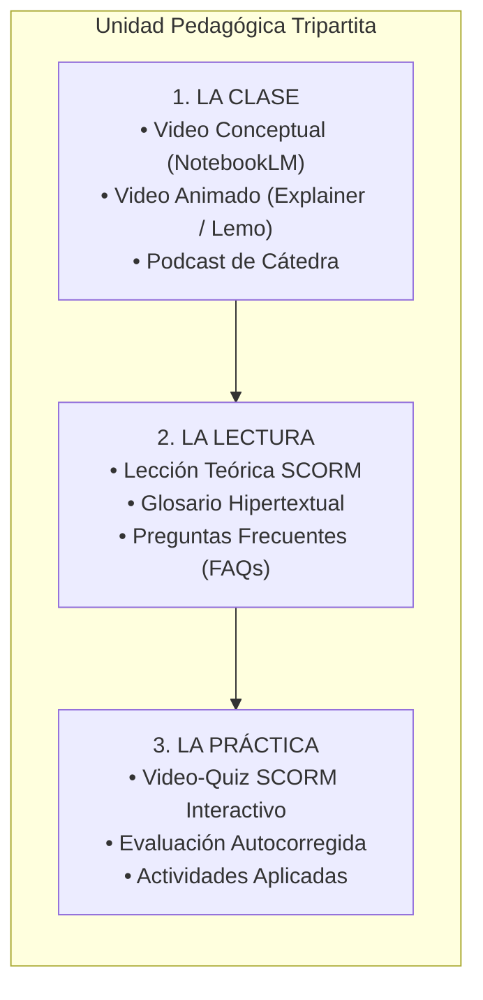

# Manual de Uso Oficial · Ecosistema EducAI & SCORM Course Generator

Manual operativo y guía de referencia para docentes, diseñadores instruccionales, administradores de campus virtual y desarrolladores.

---

## 📑 Tabla de Contenidos

1. [Introducción y Modelo Pedagógico](#1-introducción-y-modelo-pedagógico)
2. [Configuración Inicial y Diagnóstico del Entorno](#2-configuración-inicial-y-diagnóstico-del-entorno)
3. [Flujo 1: Creación de Cursos Escritos y Evaluaciones SCORM](#3-flujo-1-creación-de-cursos-escritos-y-evaluaciones-scorm)
   - [3.1. Vía Conversacional con Agentes](#31-vía-conversacional-con-agentes)
   - [3.2. Vía Markdown Clásico (`create_scorm_package.py`)](#32-vía-markdown-clásico-create_scorm_packagepy)
   - [3.3. Vía SCORM Moderno con Quiz Autoevaluable (`scorm_modern`)](#33-vía-scorm-moderno-con-quiz-autoevaluable-scorm_modern)
4. [Flujo 2: Generación de Podcasts Pedagógicos de Cátedra](#4-flujo-2-generación-de-podcasts-pedagógicos-de-cátedra)
   - [4.1. Redacción de Guiones Dialógicos A/B](#41-redacción-de-guiones-dialógicos-ab)
   - [4.2. Síntesis y Masterización con `podcast_engine.py`](#42-síntesis-y-masterización-con-podcast_enginepy)
   - [4.3. Empaquetado como SCORM de Audio](#43-empaquetado-como-scorm-de-audio)
5. [Flujo 3: Estudio Audiovisual EducAI (Producción de Videos Didácticos)](#5-flujo-3-estudio-audiovisual-educai-producción-de-videos-didácticos)
   - [5.1. Decisión de Producción: Video Común vs. Video-Cuestionario SCORM](#51-decisión-de-producción-video-común-vs-video-cuestionario-scorm)
   - [5.2. Ingesta de Documentos (`.pptx`, `.docx`, `.pdf`)](#52-ingesta-de-documentos-pptx-docx-pdf)
   - [5.3. Extracción de Identidad Visual Institucional](#53-extracción-de-identidad-visual-institucional)
   - [5.4. Menú de Estilos Gráficos (Explainer, Pizarra, Lemo, Motion Graphics)](#54-menú-de-estilos-gráficos-explainer-pizarra-lemo-motion-graphics)
   - [5.5. Subtítulos Dinámicos Estilo CapCut y Sincronía Temporal](#55-subtítulos-dinámicos-estilo-capcut-y-sincronía-temporal)
   - [5.6. Compuertas de Calidad Pre-Render y Post-Render (Zero Mocks)](#56-compuertas-de-calidad-pre-render-y-post-render-zero-mocks)
   - [5.7. Ejecución con el Orquestador Unificado (`orchestrator.py`)](#57-ejecución-con-el-orquestador-unificado-orchestratorpy)
6. [Flujo 4: Empaquetado SCORM Interactivo y Despliegue en Moodle](#6-flujo-4-empaquetado-scorm-interactivo-y-despliegue-en-moodle)
   - [6.1. Arquitectura Dual ZIP: Completo vs. Zero-Weight CDN](#61-arquitectura-dual-zip-completo-vs-zero-weight-cdn)
   - [6.2. Importación Paso a Paso en Moodle LMS](#62-importación-paso-a-paso-en-moodle-lms)
   - [6.3. Verificación de Calificaciones y Seguimiento CMI](#63-verificación-de-calificaciones-y-seguimiento-cmi)
7. [Guía Rápida de Comandos (Cheatsheet)](#7-guía-rápida-de-comandos-cheatsheet)
8. [Resolución de Problemas Frecuentes (Troubleshooting)](#8-resolución-de-problemas-frecuentes-troubleshooting)

---

## 1. Introducción y Modelo Pedagógico

El sistema está concebido para generar experiencias de e-learning universales en formato **SCORM 1.2**, compatibles con cualquier LMS moderno (**Moodle, Canvas, Blackboard, Google Classroom, D2L Brightspace, etc.**).

Toda la producción pedagógica se articula sobre la **Estructura Tripartita de Cátedra**:



1. **La Clase:** Espacio de exposición y encuadre conceptual donde conviven recursos audiovisuales (video conceptual narrado, video explicativo animado y podcast dialógico).
2. **La Lectura:** Profundización teórica estructurada, glosarios y lecturas formativas empaquetadas en HTML interactivo responsivo.
3. **La Práctica:** Actividades de transferencia, retos gamificados y evaluaciones autocorregidas que impactan directamente en el libro de calificaciones del LMS.

---

## 2. Configuración Inicial y Diagnóstico del Entorno

### 2.1. Requisitos Previos

Asegúrate de contar con las siguientes herramientas instaladas en tu sistema:
- **Python:** 3.8 o superior (probado en Python 3.9 a 3.14).
- **FFmpeg y FFprobe:** Indispensable para multiplexado de audio/video, subtítulos ASS y análisis de streams.
  - *Windows:* `winget install Gyan.FFmpeg`
  - *macOS:* `brew install ffmpeg`
  - *Linux (Ubuntu/Debian):* `sudo apt install ffmpeg`
- **Node.js:** Versión 18 o superior (para compilación y simulación de Canvas en Explainer).

### 2.2. Instalación de Dependencias

```bash
# 1. Crear y activar entorno virtual
python -m venv venv

# En Windows (PowerShell):
.\venv\Scripts\Activate.ps1

# En macOS/Linux:
source venv/bin/activate

# 2. Instalar dependencias principales
pip install -r requirements.txt

# 3. Instalar dependencias opcionales de video y documentos
pip install -r requirements-video.txt
```

### 2.3. Diagnóstico Automático con `doctor.py`

Antes de iniciar cualquier producción audiovisual o parsing de documentos, ejecuta la herramienta de diagnóstico:

```bash
python scripts/video_engine/doctor.py
```

El script verificará el estado de tus binarios CLI y librerías Python, mostrando un reporte con indicadores visuales:

```text
=======================================================
🩺 EducAI Video Studio · Diagnóstico del Entorno (Doctor)
=======================================================

🖥️  1. Herramientas del Sistema (CLI Binaries):
  ✅ ffmpeg    : Disponible (FFmpeg 9.0.2)
  ✅ ffprobe   : Disponible (FFprobe 9.0.2)
  ✅ node      : Disponible (v25.7.0)

🐍 2. Librerías de Python para Audio y Video:
  ✅ edge-tts       : v7.3.1
  ✅ Pillow         : v13.0.0
  ✅ PyYAML         : v6.0.3
  ✅ playwright     : v1.58.0

📄 3. Librerías de Ingesta Docente (Document Parsers):
  ✅ python-docx    : v1.2.0
  ✅ python-pptx    : v1.0.2
  ✅ pypdf          : v6.16.1
  ✅ pymupdf        : v2.1
  ✅ pdfplumber     : v0.11.10

=======================================================
🎉 ¡Entorno listo y saludable para producir videos didácticos!
=======================================================
```

---

## 3. Flujo 1: Creación de Cursos Escritos y Evaluaciones SCORM

### 3.1. Vía Conversacional con Agentes

Si utilizas Antigravity o Claude Code, puedes dirigir la creación en lenguaje natural:
1. **Paso 1 (Estructuración):** Invoca a `course-outliner` indicando tu tema:  
   > *"Quiero diseñar un curso de 4 semanas sobre Sistemas de Salud Comparados bajo el Modelo Tripartito."*
2. **Paso 2 (Redacción):** Pide a `content-creator` redactar las lecciones a partir del esquema.
3. **Paso 3 (Edición y Calidad):** Solicita a `senior-editor` realizar la revisión en 6 pasos.
4. **Paso 4 (Empaquetado):** Pide a `moodle-xml-formatter` compilar los módulos en un paquete SCORM final.

---

### 3.2. Vía Markdown Clásico (`create_scorm_package.py`)

Para cursos lineales tradicionales basados en módulos sucesivos:

1. Crea tu contenido en un archivo `course-content-edited.md`:
   ```markdown
   # Módulo 1: Introducción a la Epidemiología
   ## Objetivos de Aprendizaje
   - Comprender los determinantes sociales de la salud.
   
   ## Contenido
   La epidemiología es el estudio de la distribución y los determinantes de estados o eventos relacionados con la salud...
   
   # Módulo 2: Vigilancia Epidemiológica
   ...
   ```
2. Ejecuta el generador:
   ```bash
   python scripts/scorm_generators/create_scorm_package.py
   ```
3. El paquete SCORM listo para Moodle se creará automáticamente en la raíz con el nombre del curso (ej. `Curso_Epidemiologia-SCORM.zip`).

---

### 3.3. Vía SCORM Moderno con Quiz Autoevaluable (`scorm_modern`)

El generador moderno permite separar la lección teórica, los bloques de apoyo con videos embebidos (`:::apoyo:::`), las actividades prácticas y una evaluación autocalificable que reporta nota al LMS.

1. **Crea el archivo `config.yaml`:**
   ```yaml
   identificador: salud-digital-u1
   titulo: "Unidad 1: Fundamentos de Salud Digital"
   contenido_md: contenido.md
   salida_dir: output
   puntaje_minimo: 70
   enlaces:
     - titulo: "Repositorio Oficial de Salud Digital"
       url: "https://ejemplo.gob.ar/salud-digital"
       descripcion: "Normativas y estándares HL7 FHIR."
   ```

2. **Estructura el archivo `contenido.md`:**
   ```markdown
   # Clase: Transformación Digital Sanitaria
   La digitalización de los procesos de atención optimiza la continuidad asistencial...

   :::apoyo
   Video explicativo sobre interoperabilidad de historias clínicas:
   VIDEO: https://www.youtube.com/watch?v=EjemploID
   :::

   # Actividad: Mapeo de Flujos Asistenciales
   Identifique tres puntos críticos donde se pierden datos clínicos en un hospital tradicional.

   # Evaluación: Cuestionario de la Unidad 1
   Responda las siguientes preguntas formativas:

   ## Pregunta 1
   ¿Qué estándar internacional facilita el intercambio de datos en salud?
   A) DICOM exclusivamente para texto
   B) HL7 FHIR
   C) JPEG 2000
   D) ASCII básico

   **Respuesta correcta: B**
   **Explicación:** HL7 FHIR es el estándar abierto por excelencia para interoperabilidad en salud digital.
   ```

3. **Valida y Construye el Paquete:**
   ```bash
   # Validar estructura y preguntas sin generar archivos
   python scripts/scorm_generators/create_scorm_modern_package.py validate config.yaml

   # Construir el paquete SCORM final
   python scripts/scorm_generators/create_scorm_modern_package.py build config.yaml
   ```
   *Salida generada:* `output/salud-digital-u1-SCORM.zip`.

---

## 4. Flujo 2: Generación de Podcasts Pedagógicos de Cátedra

Los podcasts formativos enriquecen el bloque **La Clase**, permitiendo a los estudiantes repasar conceptos clave mientras viajan o realizan otras actividades.

### 4.1. Redacción de Guiones Dialógicos A/B

El motor utiliza dos voces neurales con acento rioplatense auténtico:
- **Locutora A (`Elena` / `es-AR-ElenaNeural`):** Voz docente principal, formal, pedagógica y cálida.
- **Locutor B (`Tomás` / `es-AR-TomasNeural`):** Voz copresentadora o estudiante avanzado, formula preguntas disparadoras y plantea casos clínicos.

Formato estándar del guion (`guion.txt`):
```text
A: ¡Hola a todos y bienvenidos a esta cápsula de La Clase! Hoy vamos a analizar los modelos de seguro social versus sistemas nacionales de salud.
B: Hola Elena. Es un debate clásico: ¿cuál es la diferencia central en la fuente de financiamiento?
A: La clave está en el aporte: el modelo Bismarck se financia con contribuciones sobre la nómina salarial, mientras que el modelo Beveridge se sostiene mediante rentas generales e impuestos.
B: Excelente síntesis. En la próxima sección veremos ejemplos concretos en América Latina.
```

### 4.2. Síntesis y Masterización con `podcast_engine.py`

Ejecuta la síntesis desde la consola o desde un script de Python:

```bash
python -c "from scripts.audio_generators.podcast_engine import generate_podcast_sync; generate_podcast_sync(open('guion.txt', encoding='utf-8').read(), 'podcast_unidad_1.mp3')"
```

El motor aplica automáticamente una cadena de masterización acústica con FFmpeg:
- Filtro paso alto a 90 Hz (elimina ruidos de fondo).
- Calidez vocal en frecuencias medias y reducción de sibilancias (`deesser`).
- Compresión de rango dinámico y normalización de sonoridad profesional (`loudnorm=I=-16 LUFS`).

### 4.3. Empaquetado como SCORM de Audio

Para que la escucha del podcast se registre como actividad completada en Moodle:

```bash
python scripts/scorm_generators/create_audio_scorm.py podcast_unidad_1.mp3 "Podcast: Modelos de Salud" "Cápsula explicativa de La Clase"
```
*Salida:* `podcast_unidad_1-SCORM.zip` con reproductor HTML5 que cambia el estado a `completed` al llegar al 100% del audio.

---

## 5. Flujo 3: Estudio Audiovisual EducAI (Producción de Videos Didácticos)

El estudio de video determinista en `scripts/video_engine/` permite convertir documentos o prompts en videos Full HD con sincronía palabra por palabra.

### 5.1. Decisión de Producción: Video Común vs. Video-Cuestionario SCORM

| Aspecto | Caso A: Video Común Lineal (MP4) | Caso B: Video-Cuestionario SCORM 1.2 |
| :--- | :--- | :--- |
| **Entregable** | Archivo `.mp4` Full HD 1080p continuo. | Paquetes `.zip` Dual (Completo y Zero-Weight). |
| **Pausas Evaluativas** | Sin pausas. | Se detiene automáticamente al terminar cada concepto. |
| **Interacción** | Pasiva (reproducción tradicional). | Activa (el alumno debe responder para avanzar). |
| **Calificación LMS** | No califica o registra tracking de visualización. | Reporta nota (`score.raw`) en el libro de calificaciones de Moodle. |
| **Ubicación Ideal** | **La Clase** (`02_la_clase.html`), YouTube o proyección. | **La Práctica** (`04_la_practica.html`) o examen formativo. |

---

### 5.2. Ingesta de Documentos (`.pptx`, `.docx`, `.pdf`)

No necesitas escribir el guion desde cero si ya tienes materiales de cátedra:

```bash
# Ingestar presentación de PowerPoint extrayendo diapositivas y notas del orador
python scripts/video_engine/parsers/doc_parser.py mi_clase.pptx -o scenes.json

# Ingestar documento de Word
python scripts/video_engine/parsers/doc_parser.py programa.docx -o scenes.json
```

> [!TIP]
> **Notas del Orador en PowerPoint:** El parser prioriza las notas del orador para armar el guion de locución (`narration`) y utiliza el contenido visual de la diapositiva para los elementos en pantalla (`screen_elements`).

---

### 5.3. Extracción de Identidad Visual Institucional

Puedes suministrar el logotipo o membrete de tu universidad o institución (`.jpg`, `.png`). El extractor cuantiza los colores dominantes y genera variables CSS accesibles con ratio de contraste WCAG AA:

```bash
python scripts/video_engine/parsers/brand_theme.py logo_institucional.png -o theme_config.json
```

---

### 5.4. Menú de Estilos Gráficos

El orquestador soporta múltiples motores visuales seleccionables mediante el parámetro `--engine`:

1. **`explainer` (Explainer Canvas 2D Declarativo):**
   - Animaciones vectoriales adaptables en Canvas HTML5.
   - Soporta formato **horizontal `16:9`** (Moodle/clases) y **vertical `9:16`** (TikTok/Reels/Campus Móvil).
   - 6 temas predefinidos: Pizarra, Noche, Papel, Plano color, Plano técnico y Tu marca.
2. **`whiteboard` / `canvas` (Pizarra Didáctica Tradicional):**
   - Trazado progresivo a mano alzada, diagramas limpios y notas visuales sobre pizarra. Ideal para matemáticas, medicina y explicaciones paso a paso.
3. **`motion_graphics` (Tarjetas Dinámicas EducAI - Predeterminado):**
   - Tarjetas de escena dinámicas con fondos estilizados, banners superiores, barra de progreso temporal y tipografía de alto impacto.
4. **`lemo-opuscar` (99 Estilos Artísticos por Código):**
   - Estilos visuales de autor: Blueprint, Ukiyo-e, Grabado Vintage, Acuarela, Terminal CRT, Isométrico, etc.

---

### 5.5. Subtítulos Dinámicos Estilo CapCut

> [!IMPORTANT]
> **Invariante 5 (Subtítulos por Defecto):** Todos los videos generados incorporan subtítulos dinámicos palabra por palabra estilo CapCut / TikTok.
> Cada palabra se resalta en el color de acento de la institución en el milisegundo exacto en que la voz la pronuncia. Para desactivarlos, añade el flag `--no-captions`.

---

### 5.6. Compuertas de Calidad Pre-Render y Post-Render (Zero Mocks)

El pipeline incluye dos compuertas de auditoría técnica que previenen renders fallidos:
- **Pre-Render Gate (`pre_render.py`):**
  - Verifica que la duración del audio coincida con el timeline ($\pm 0.5\text{s}$).
  - **Invariante 1:** Comprueba que ningún checkpoint corte la locución antes de que finalice la frase (`timestamp >= scene_end + 0.08s`).
  - Audita el archivo HTML en headless Chrome comprobando que no existan errores de consola.
- **Post-Render Gate (`post_render.py`):**
  - Inspecciona el archivo MP4 compilado con `ffprobe`.
  - Verifica exactamente 1 stream de video H.264 (1080p) y 1 stream de audio estéreo AAC (44.1 kHz).
  - Ejecuta `silencedetect` para asegurar que el audio no se corte abruptamente al final y comprueba que no haya fotogramas negros en blanco.

---

### 5.7. Ejecución con el Orquestador Unificado (`orchestrator.py`)

Crea un proyecto completo en una sola línea de comando:

```bash
# Caso A: Video Común Lineal Full HD con subtítulos CapCut
python scripts/video_engine/orchestrator.py films/clase-epidemiologia \
    --doc material.pptx \
    --title "Epidemiología Crítica" \
    --logo logo_facultad.jpg \
    --linear

# Caso B: Video-Cuestionario SCORM 1.2 Interactivo con pausas evaluativas
python scripts/video_engine/orchestrator.py films/clase-epidemiologia \
    --doc material.docx \
    --title "Epidemiología Crítica" \
    --logo logo_facultad.jpg

# Producción con motor Explainer Canvas en formato vertical para campus móvil
python scripts/video_engine/orchestrator.py films/reel-epidemiologia \
    --engine explainer \
    --aspect 9:16 \
    --title "Microlearning: R0"

# Reanudar un render interrumpido sin volver a procesar fotogramas
python scripts/video_engine/orchestrator.py films/clase-epidemiologia --skip-render
```

---

## 6. Flujo 4: Empaquetado SCORM Interactivo y Despliegue en Moodle

### 6.1. Arquitectura Dual ZIP: Completo vs. Zero-Weight CDN

El empaquetador genera simultáneamente dos variantes de paquete SCORM:

```
films/mi-proyecto/
├── Mi_Clase_EducAI_Final.mp4                     <-- Video MP4 Full HD 1080p
├── Mi_Clase_SCORM_Completo.zip                  <-- Paquete Autocontenido (incluye el .mp4)
└── Mi_Clase_SCORM.zip                           <-- Paquete Zero-Weight (< 400 KB)
```

- **¿Cuándo usar `_SCORM_Completo.zip`?**  
  Cuando tu campus Moodle admite archivos grandes (ej. límites de 100 MB o 200 MB) y prefieres que todo el recurso resida internamente sin depender de servidores externos.
- **¿Cuándo usar `_SCORM.zip` (Zero-Weight)?**  
  Cuando tu Moodle tiene un límite estricto de subida (ej. 2 MB a 10 MB). Subes el video `.mp4` a un servidor de almacenamiento institucional (AWS S3, Google Cloud Storage, Cloudflare R2 o un servidor web propio con soporte byte-range) y el paquete SCORM solo pesa ~5 KB, cargando el video vía streaming.

---

### 6.2. Importación Paso a Paso en Moodle LMS

1. Ingresa a tu aula virtual en Moodle y activa el **Modo de Edición** (esquina superior derecha).
2. En la sección deseada (**La Clase** o **La Práctica**), haz clic en **"Añadir una actividad o un recurso"**.
3. Selecciona **"Paquete SCORM"**.
4. Completa los campos principales:
   - **Nombre:** Título de la actividad (ej. *Video-Cuestionario: Determinantes de la Salud*).
   - **Descripción:** Instrucciones para los estudiantes.
   - **Paquete:** Arrastra y suelta el archivo `_SCORM_Completo.zip` (o `_SCORM.zip`).
5. Configura los parámetros recomendados:
   - **Apariencia:**
     - *Mostrar paquete:* **Ventana actual** o **Nueva ventana** (recomendado para maximizar el área de video).
     - *Ancho / Alto:* `100%` / `100%` (el reproductor es totalmente responsivo).
   - **Calificación:**
     - *Método de calificación:* **Calificación más alta** o **Primer intento**.
     - *Calificación máxima:* `100` (las preguntas calculan el puntaje automáticamente de 0 a 100).
   - **Ajustes de disponibilidad y finalización:**
     - Marcar como completado cuando el estudiante reciba una calificación aprobatoria.
6. Haz clic en **"Guardar cambios y regresar al curso"**.

---

### 6.3. Verificación de Calificaciones y Seguimiento CMI

Cuando el estudiante visualiza el video:
1. El video se reproduce normalmente. En la barra superior, una píldora informativa indica: `Próxima Pregunta: <Concepto> (en MM:SS)`.
2. Al llegar al timestamp del checkpoint, el video se pausa de inmediato y se despliega el cuadro de diálogo interactivo.
3. El alumno selecciona su opción y presiona **"Confirmar Respuesta"**:
   - Si acierta, recibe feedback positivo en verde y suma puntaje.
   - Si falla, recibe la explicación pedagógica formativa.
4. Al concluir el video, el reproductor invoca automáticamente las llamadas estándar de SCORM:
   ```javascript
   API.LMSSetValue("cmi.core.score.raw", finalScore); // 0 a 100
   API.LMSSetValue("cmi.core.lesson_status", passed ? "passed" : "completed");
   API.LMSCommit("");
   API.LMSFinish("");
   ```
5. El docente puede comprobar las notas en el **Libro de Calificaciones** de Moodle de forma inmediata.

---

## 7. Guía Rápida de Comandos (Cheatsheet)

| Tarea / Objetivo | Comando |
| :--- | :--- |
| **Diagnóstico del entorno** | `python scripts/video_engine/doctor.py` |
| **Producción E2E de video desde Word** | `python scripts/video_engine/orchestrator.py films/u1 --doc clase.docx --logo logo.jpg` |
| **Producción E2E de video desde PowerPoint** | `python scripts/video_engine/orchestrator.py films/u1 --doc clase.pptx --title "Título"` |
| **Video Común Lineal (sin SCORM)** | `python scripts/video_engine/orchestrator.py films/u1 --doc clase.pptx --linear` |
| **Video Explainer Canvas en 9:16** | `python scripts/video_engine/orchestrator.py films/u1 --engine explainer --aspect 9:16` |
| **Simulación de Explainer sin navegador** | `node scripts/video_engine/engines/explainer/simular.cjs films/u1/index.html --todos` |
| **SCORM de Video Pasivo (90% visto)** | `python scripts/scorm_generators/create_video_scorm.py video.mp4 "Clase 1"` |
| **SCORM de Video con Checkpoints** | `python scripts/scorm_generators/create_video_scorm.py video.mp4 --checkpoints preguntas.json` |
| **Podcast Pedagógico de 2 voces** | `python -c "from scripts.audio_generators.podcast_engine import generate_podcast_sync; generate_podcast_sync('A: ...\nB: ...', 'podcast.mp3')"` |
| **SCORM de Audio** | `python scripts/scorm_generators/create_audio_scorm.py podcast.mp3 "Podcast U1"` |
| **SCORM Moderno (Lección + Quiz)** | `python scripts/scorm_generators/create_scorm_modern_package.py build config.yaml` |
| **Compresión FFmpeg optimizada (CRF 23)** | `ffmpeg -i video.mp4 -vcodec libx264 -crf 23 -preset medium -acodec aac -b:a 128k out.mp4` |
| **Ejecutar Suite de Tests Unitarios** | `python -m unittest scripts.video_engine.tests.test_video_engine` |

---

## 8. Resolución de Problemas Frecuentes (Troubleshooting)

### 1. Error en PowerShell: "La ejecución de scripts está deshabilitada en este sistema"
- **Causa:** Política de seguridad restrictiva de Windows para archivos `.ps1`.
- **Solución:** Ejecuta PowerShell con permisos temporales de bypass:
  ```powershell
  Set-ExecutionPolicy -ExecutionPolicy Bypass -Scope Process
  ```
  O ejecuta los comandos de Node mediante `cmd.exe /c "npm ..."` o `node ...`.

### 2. Moodle rechaza el archivo ZIP por superar el tamaño máximo permitido
- **Causa:** El paquete autocontenido `_SCORM_Completo.zip` supera el límite de `upload_max_filesize` configurado en el servidor PHP/Moodle.
- **Solución A:** Usa el paquete **Zero-Weight** (`*_SCORM.zip`, < 400 KB) alojando el MP4 en un servidor externo.
- **Solución B:** Comprime el video original con FFmpeg utilizando un CRF más alto:
  ```bash
  ffmpeg -i video_pesado.mp4 -vcodec libx264 -crf 28 -preset fast -acodec aac -b:a 96k video_comprimido.mp4
  ```
- **Solución C:** Consulta la guía [GUIA_AUMENTAR_LIMITE_UPLOAD_MOODLE.md](GUIA_AUMENTAR_LIMITE_UPLOAD_MOODLE.md) para ajustar `php.ini` si tienes acceso al servidor.

### 3. Las preguntas evaluativas aparecen sobre fondo negro en pantalla completa
- **Causa:** Se utilizó el botón nativo de pantalla completa del elemento `<video>`. En HTML5, maximizar `<video>` coloca el stream en una capa gráfica por encima de cualquier capa DOM superpuesta (`<div>`).
- **Solución:** Utiliza siempre el reproductor seguro generado por el sistema, el cual bloquea `controlsList="nofullscreen"` y maximiza `#player-container`, asegurando que los diálogos de evaluación se mantengan siempre visibles en primer plano.

### 4. Advertencia de Pre-Render Gate: "Checkpoint at XXs cuts scene speech"
- **Causa:** Se configuró manualmente un checkpoint en un segundo donde la locución de la escena todavía está hablando.
- **Solución:** El orquestador alinea automáticamente los checkpoints al invocar `scripts/video_engine/orchestrator.py`. Si editas `checkpoints.json` manualmente, asegúrate de colocar cada timestamp en `end + 0.08s` consultando `audio_timeline.json`.

---

*Manual elaborado conforme a los estándares de producción didáctica y técnica de EducAI.*
